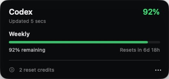

<div align="center">

# Vibelimit

**Your Codex limits, quietly visible in the macOS menu bar.**

[](https://github.com/Simskii/vibelimit/releases)
[](https://github.com/Simskii/vibelimit/releases/latest)
[](https://github.com/Simskii/vibelimit/actions/workflows/ci.yml)
[](LICENSE)

<br />



<br />

[Download the latest DMG](https://github.com/Simskii/vibelimit/releases/latest) · [View source](https://github.com/Simskii/vibelimit)

</div>

## Why Vibelimit?

Codex limits are easy to forget until they interrupt your work. Vibelimit keeps
the remaining capacity and next reset visible without requiring another browser
tab, dashboard, or sign-in.

- Remaining Codex capacity directly in the menu bar
- Clear limit windows, progress bars, and reset countdowns
- Optional notifications when capacity is low, exhausted, or restored
- Reset-credit and stale-data status
- Launch at login, no Dock icon, and a compact native interface
- Read-only access through the local Codex App Server

## Install

1. Download the latest `Vibelimit-*.dmg` from
   [GitHub Releases](https://github.com/Simskii/vibelimit/releases/latest).
2. Open the DMG and drag **Vibelimit** to **Applications**.
3. Launch Vibelimit. Its current Codex percentage appears in the menu bar.

Unsigned preview releases require one additional first-launch step: right-click
Vibelimit in Finder and choose **Open**. Developer ID signed and notarized
releases open normally through Gatekeeper.

### Requirements

- macOS 13 Ventura or later
- ChatGPT for macOS or a Codex CLI build that supports `app-server`
- An existing Codex sign-in

## Privacy

Vibelimit communicates only with a local `codex app-server --stdio` process and
calls the read-only `account/rateLimits/read` method. It does not:

- store credentials or usage history
- initiate login
- consume reset credits
- modify Codex configuration
- scrape ChatGPT
- send analytics

## Build from source

```sh
xcodebuild \
  -project Vibelimit.xcodeproj \
  -scheme Vibelimit \
  -configuration Debug \
  -derivedDataPath build/DerivedData \
  test
```

Build and package a local DMG:

```sh
xcodebuild \
  -project Vibelimit.xcodeproj \
  -scheme Vibelimit \
  -configuration Release \
  -derivedDataPath build/DerivedData \
  build

Scripts/package_release.sh 1.0.0
```

The DMG and its SHA-256 checksum are written to `build/release/`.

## Releases

Every push to `main` runs the test suite and updates a Release Please pull
request from conventional commits. Merging that pull request creates the next
semantic version and automatically builds, verifies, and publishes its DMG and
checksum to GitHub Releases. The release workflow can also be run manually.

When the five Apple release secrets documented in
[`.github/workflows/release.yml`](.github/workflows/release.yml) are configured,
the same workflow Developer ID-signs and notarizes the DMG before publishing it.
Notarization is a Gatekeeper security check for direct downloads; it does not
publish Vibelimit to the Mac App Store.

## Author

Built by [Simon Lundh](https://simonlundh.se).

## License

[MIT](LICENSE)
